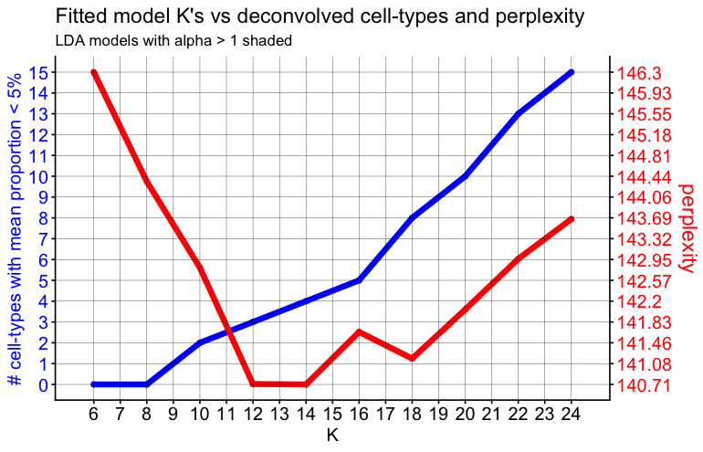
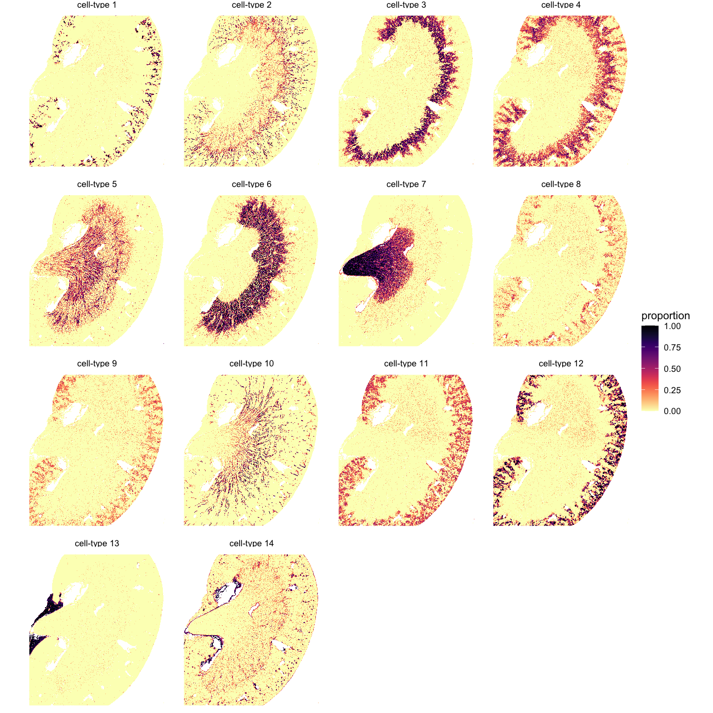
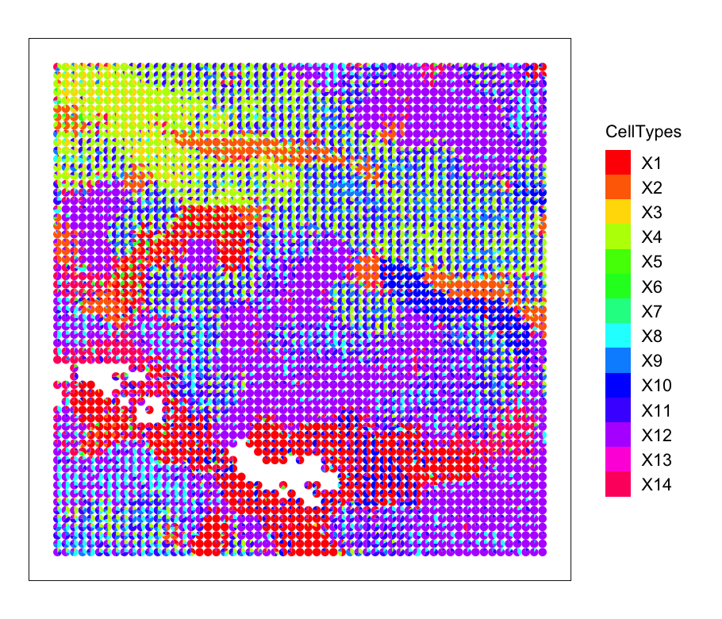
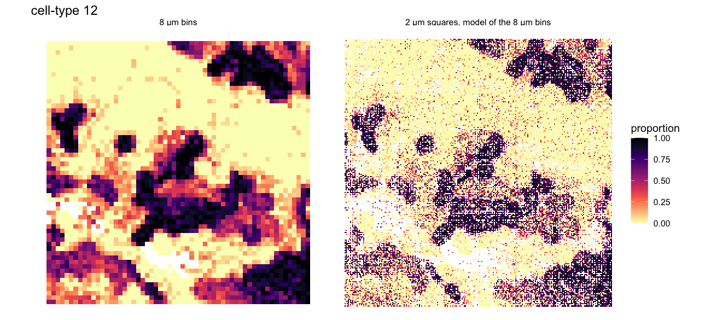

Analysis of 10X Visium HD data
================

# Summary

Visium HD measures gene expression in 2 µm squares, which are usually
analysed after binning them into 8 µm or 16 µm bins. Compared to the
datasets in the other tutorials, such a dataset has

- **very many pixels**: hundreds of thousands of 8 µm bins instead of a
  few thousand spots, and
- **few counts per pixel**: a few hundred instead of tens of thousands.

`STdeconvolve` works on such data, but two default settings were chosen
for datasets with a few thousand large spots and should be changed:

1.  `removeBelow` of `restrictCorpus()` removes the genes that are
    detected in few pixels. Its default of 5% removes the marker genes
    of every cell-type that covers a small part of the tissue.
2.  `max.counts` of `fitLDA()` fits the models on a random subset of the
    pixels. This is many times faster and gives the same models, because
    the gene expression profiles of the cell-types are well determined
    by far fewer than all pixels.

This tutorial shows both on the 8 µm bins of a mouse kidney, and ends
with what to expect from the 2 µm squares.

# Data

We use the [Visium HD mouse kidney
dataset](https://www.10xgenomics.com/datasets/visium-hd-cytassist-gene-expression-libraries-of-mouse-kidney)
of 10X Genomics. The counts of all bin sizes are in one archive (9.5
GB), of which we need the filtered count matrix and the bin positions of
the 8 µm bins, and the count matrix of the 2 µm squares for the last
section.

``` r
f <- "visiumHDTutorial/"
files <- c("binned_outputs/square_008um/filtered_feature_bc_matrix.h5",
           "binned_outputs/square_008um/spatial/tissue_positions.parquet",
           "binned_outputs/square_002um/filtered_feature_bc_matrix.h5")

if (!all(file.exists(paste0(f, files)))) {
  dir.create(f, showWarnings = FALSE)
  options(timeout = 3600)
  archive <- paste0(f, "Visium_HD_Mouse_Kidney_binned_outputs.tar.gz")
  download.file(paste0("https://cf.10xgenomics.com/samples/spatial-exp/3.0.0/",
                       "Visium_HD_Mouse_Kidney/Visium_HD_Mouse_Kidney_binned_outputs.tar.gz"),
                destfile = archive)
  untar(archive, files = files, exdir = f)
}
```

The count matrices are stored in the HDF5 format of 10X Genomics. This
function reads one as a sparse genes x bins matrix. It needs the `hdf5r`
package; the bin positions are read with the `arrow` package.

``` r
library(STdeconvolve)
library(Matrix)
library(ggplot2)

read10xH5 <- function(file) {
  h5 <- hdf5r::H5File$new(file, mode = "r")
  on.exit(h5$close_all())
  m <- h5[["matrix"]]
  sparseMatrix(i = m[["indices"]][] + 1L,
               p = m[["indptr"]][],
               x = as.numeric(m[["data"]][]),
               dims = m[["shape"]][],
               dimnames = list(make.unique(m[["features/name"]][]),
                               m[["barcodes"]][]))
}
```

``` r
cd <- read10xH5(paste0(f, files[1]))
dim(cd)
```

    ## [1]  19059 502009

``` r
pos <- as.data.frame(arrow::read_parquet(paste0(f, files[2])))
## position of each bin on the grid of bins. Rows are counted from the top.
pos <- data.frame(x = pos$array_col, y = -pos$array_row, row.names = pos$barcode)
pos <- pos[colnames(cd), ]
```

There are 502,009 bins. Half of them have fewer than 405 counts:

``` r
summary(colSums(cd))
```

    ##    Min. 1st Qu.  Median    Mean 3rd Qu.    Max. 
    ##     0.0   269.0   405.0   466.7   603.0  4264.0

# Cleaning

We keep the bins with at least 100 counts.

``` r
counts <- cleanCounts(cd, min.lib.size = 100)
dim(counts)
```

    ## [1]  18945 488458

# Selecting genes: `removeBelow`

`restrictCorpus()` selects the genes for the model in two steps. It
first removes the genes that are detected in more than a fraction
`removeAbove` or in less than a fraction `removeBelow` of the pixels,
and then keeps the (up to `nTopOD = 1000`) most overdispersed of the
remaining genes.

The default `removeBelow = 0.05` asks for genes that are detected in at
least 5% of the pixels. With the large spots of other technologies,
where every spot contains several cells and many counts, this removes
noise. A small bin with few counts is different: a gene is only detected
in the bins that contain a cell expressing it, and often not even there.
Marker genes of cell-types that make up a small part of the tissue are
therefore detected in far fewer than 5% of the bins.

Here is the fraction of bins in which some well-known marker genes of
kidney cell-types are detected:

``` r
markers <- c("proximal tubule S1" = "Slc5a2", "proximal tubule" = "Slc34a1",
             "proximal tubule S3" = "Slc7a13", "thick ascending limb" = "Umod",
             "distal convoluted tubule" = "Slc12a3", "principal cell" = "Aqp2",
             "intercalated cell" = "Atp6v1b1", "intercalated cell B" = "Slc26a4",
             "podocyte" = "Nphs2", "juxtaglomerular cell" = "Ren1",
             "endothelial cell" = "Emcn", "fibroblast" = "Col1a1",
             "smooth muscle" = "Acta2", "macrophage" = "C1qa",
             "urothelium" = "Upk1b")
detected <- rowSums(counts[markers, ] > 0) / ncol(counts)
data.frame(celltype = names(markers), gene = markers,
           percent.of.bins = round(100 * detected, 2), row.names = NULL)
```

    ##                    celltype     gene percent.of.bins
    ## 1        proximal tubule S1   Slc5a2           10.59
    ## 2           proximal tubule  Slc34a1           28.22
    ## 3        proximal tubule S3  Slc7a13           15.55
    ## 4      thick ascending limb     Umod           44.99
    ## 5  distal convoluted tubule  Slc12a3            5.43
    ## 6            principal cell     Aqp2           12.09
    ## 7         intercalated cell Atp6v1b1            2.29
    ## 8       intercalated cell B  Slc26a4            1.39
    ## 9                  podocyte    Nphs2            0.53
    ## 10     juxtaglomerular cell     Ren1            1.01
    ## 11         endothelial cell     Emcn            8.02
    ## 12               fibroblast   Col1a1            2.73
    ## 13            smooth muscle    Acta2            1.91
    ## 14               macrophage     C1qa            1.08
    ## 15               urothelium    Upk1b            0.62

More than half of these genes are detected in less than 5% of the bins.
With the default setting, the model would never see them:

``` r
corpusDefault <- restrictCorpus(counts, removeAbove = 1.0, removeBelow = 0.05,
                                verbose = FALSE)
dim(corpusDefault)
```

    ## [1]    504 488458

``` r
setdiff(markers, rownames(corpusDefault))
```

    ## [1] "Atp6v1b1" "Slc26a4"  "Nphs2"    "Ren1"     "Col1a1"   "Acta2"    "C1qa"     "Upk1b"

Only 504 genes are left, and podocytes, juxtaglomerular cells,
intercalated cells, fibroblasts, smooth muscle, macrophages and
urothelium have lost their marker genes. Podocytes, for example, are
found only in the glomeruli, which fill about half a percent of the
bins.

With `removeBelow = 0.005` (half a percent of the bins, here about 2,442
bins) the full 1,000 genes are selected and all of these markers are
among them:

``` r
corpus <- restrictCorpus(counts, removeAbove = 1.0, removeBelow = 0.005,
                         verbose = FALSE)
dim(corpus)
```

    ## [1]   1000 488458

``` r
setdiff(markers, rownames(corpus))
```

    ## character(0)

As a rule of thumb, set `removeBelow` below the fraction of the pixels
that you expect the rarest cell-type of interest to occupy. A gene that
is detected in a few thousand bins is still supported by plenty of data,
so there is little risk in a low value for a dataset of this size.

`fitLDA()` needs a pixels x genes matrix in which each pixel has at
least one count:

``` r
corpus <- t(corpus)
corpus <- corpus[rowSums(corpus) > 0, ]
dim(corpus)
```

    ## [1] 488458   1000

``` r
mean(rowSums(corpus))
```

    ## [1] 100.372

# Fitting the models: `max.counts`

An LDA model has two parts: the gene expression profile of each
cell-type (`beta`, shared by all pixels) and the proportions of the
cell-types in each pixel (`theta`). Fitting alternates between the two,
and nearly all the time is spent on the proportions of the pixels, again
and again while the profiles improve.

The profiles are estimated from the counts of all pixels together.
Beyond a few million counts they hardly change when more pixels are
added, so there is no need to visit every pixel in every iteration. With
`max.counts`, `fitLDA()`

1.  picks pixels at random until they have `max.counts` counts together,
2.  fits the model on these pixels only,
3.  computes the cell-type proportions of **all** pixels with the fitted
    profiles, which takes a single pass over the data.

The models that are returned contain the proportions of all pixels, and
the perplexity is computed on all pixels as well, so everything
downstream works as usual.

The limit is on the number of counts and not on the number of pixels
because the counts are what the profiles are estimated from: the fewer
counts a pixel has, the more pixels are needed. `max.counts = 5e6` (5
million counts) is a good value for any bin size.

To see the effect, we fit a model with 12 cell-types on all bins and on
a subset. Set `ncores` to the number of cores of your computer; the bins
are processed in parallel.

``` r
ncores <- parallel::detectCores()

system.time(
  ldaAll <- fitLDA(corpus, Ks = 12, ncores = ncores, plot = FALSE, verbose = FALSE)
)
```

    ##    user  system elapsed 
    ## 259.843   1.159  19.627

``` r
system.time(
  ldaSubset <- fitLDA(corpus, Ks = 12, ncores = ncores, plot = FALSE, max.counts = 5e6)
)
```

    ## fitting the models on 49937 of the 488458 pixels

    ## now fitting LDA model with K = 12

    ## Time to fit LDA models was 0.05 mins

    ## Getting predicted cell-types at low proportions...

    ## Time to compute cell-types at low proportions was 0 mins

    ##    user  system elapsed 
    ##  33.097   0.287   3.309

The second fit used about a tenth of the bins and is several times
faster. The two models describe the data equally well. The perplexity
(lower is better) of both is computed on all bins:

``` r
c(all = ldaAll$perplexities, subset = ldaSubset$perplexities)
```

    ##      all   subset 
    ## 142.2026 142.3327

Their cell-types are the same, too. We match the cell-types of the two
models and look at the correlation of their gene expression profiles:

``` r
betaAll <- getBetaTheta(ldaAll$models[[1]], perc.filt = 0, verbose = FALSE)$beta
betaSubset <- getBetaTheta(ldaSubset$models[[1]], perc.filt = 0, verbose = FALSE)$beta
corMtx <- getCorrMtx(betaAll, betaSubset, type = "b", verbose = FALSE)
```

    ## NOTE: using type='b' and comparing betas where the cell-types are
    ##             the rows (cell-types x genes)

``` r
pairs <- lsatPairs(corMtx)
round(sort(corMtx[cbind(pairs$rowix, pairs$colsix)]), 2)
```

    ##  [1] 0.99 1.00 1.00 1.00 1.00 1.00 1.00 1.00 1.00 1.00 1.00 1.00

Nearly all cell-types of one model have a counterpart with almost the
same profile in the other. Do not expect a perfect match for every
cell-type: LDA models fitted from different starting points differ in
this way as well, typically by dividing one group of similar cells
differently.

## Choosing the number of cell-types

The number of cell-types `K` is chosen by fitting models for a range of
values. With `max.counts` this takes seconds per model.
`warm.start = TRUE` saves more time: the model with the largest `K` is
fitted first, and each smaller model starts from the previous one after
merging its two most similar cell-types, instead of starting from
scratch.

``` r
system.time(
  ldas <- fitLDA(corpus, Ks = seq(6, 24, by = 2), ncores = ncores,
                 max.counts = 5e6, warm.start = TRUE, verbose = FALSE)
)
```

<!-- -->

    ##    user  system elapsed 
    ## 214.908   1.938  21.620

The perplexity (red) improves up to `K = 12` to `14` and gets worse
after that, while the number of cell-types with a mean proportion below
5% (blue) grows with `K`. In a tissue that is measured at this
resolution, cell-types with a small mean proportion are expected (see
the glomeruli above), so we do not take them as a sign of overfitting
here, and continue with the model with the lowest perplexity.

``` r
optLDA <- optimalModel(models = ldas, opt = "min")
optLDA
```

    ## LDA model with 14 cell-types fitted to 488458 pixels and 1000 genes (alpha = 0.06445, 4 EM iterations)

# Results

``` r
results <- getBetaTheta(optLDA, perc.filt = 0.05, betaScale = 1000, verbose = FALSE)
deconProp <- results$theta
deconGexp <- results$beta
dim(deconProp)
```

    ## [1] 488458     14

The genes that are most specific to each cell-type, by their fold change
over the mean of all cell-types:

``` r
foldChange <- log2(t(t(deconGexp + 1e-6) / (colMeans(deconGexp) + 1e-6)))
topSpecific <- t(apply(foldChange, 1, function(x) names(sort(x, decreasing = TRUE))[1:8]))
data.frame(mean.proportion = round(colMeans(deconProp), 3),
           top.genes = apply(topSpecific, 1, paste, collapse = " "))
```

    ##    mean.proportion                                                               top.genes
    ## 1            0.028                      S100g Slc12a3 Calb1 Slc8a1 Pgam2 Pvalb Trpm6 Klhl3
    ## 2            0.059                            Cldn16 Umod Egf Casr Col5a2 Gcgr Tarm1 Scn4b
    ## 3            0.103 Serpina1a Serpina1d Serpina1b Higd1c Akr1c18 Serpina1f Slc22a19 Ceacam2
    ## 4            0.107                          Azgp1 Cyp4a10 Tmigd1 Kap Pigr Hpd Dmgdh Cyp2d9
    ## 5            0.085                       Bst1 Angpt2 Tnc Cck Rasgef1b Slc14a1 Atp2a3 Spon1
    ## 6            0.144                     Mfrp Sycn Defb42 Kcnt1 Nccrp1 Pcsk6 Tmem207 Ppp1r1b
    ## 7            0.107                   Akr1b3 Psca Aldh1a3 Lamb3 Sptssb Cldn11 Tmem238l Wnt4
    ## 8            0.030                          Ttr Car14 Cela1 Cyp4a12a Mdk Slc13a1 Miox Ftcd
    ## 9            0.033                          Cndp2 Slco1a1 Ugt2b37 Pzp Odc1 Inmt Acy3 Cckar
    ## 10           0.057                          Mcoln3 Slc4a1 Aqp6 Hsd11b2 Kcne1 Btc Foxi1 Kit
    ## 11           0.064             Nat8f5 Cyp2j13 Fcamr Ugt2b38 Slc13a3 Cyp4b1 Slc22a6 Slco1a6
    ## 12           0.099              Slc5a2 Slc34a3 Ugt2b34 Slc5a12 Spp2 Cyp2d26 Sectm1b Prodh2
    ## 13           0.025                              Fabp4 Fasn Cfd Car3 Thrsp Cox8b Cidea Ucp1
    ## 14           0.059                         Tagln Acta2 Myh11 Upk1b Upk3a Sprr1a Mgp Sema3g

Several cell-types are easy to recognise: the first segment of the
proximal tubule (cell-type 12: *Slc5a2*), the thick ascending limb (2:
*Umod*, *Cldn16*), the distal convoluted tubule (1: *Slc12a3*, *Calb1*),
the collecting duct (10: *Aqp6*, *Foxi1*, *Hsd11b2*) and the fat next to
the kidney (13: *Ucp1*, *Cidea*, *Fabp4*).

The cell-types in which the marker genes from above are most specific:

``` r
inCorpus <- markers[markers %in% colnames(foldChange)]
data.frame(celltype = names(inCorpus), gene = inCorpus,
           deconvolved.celltype = apply(foldChange[, inCorpus], 2, which.max),
           log2.fold.change = round(apply(foldChange[, inCorpus], 2, max), 1),
           row.names = NULL)
```

    ##                    celltype     gene deconvolved.celltype log2.fold.change
    ## 1        proximal tubule S1   Slc5a2                   12              3.8
    ## 2           proximal tubule  Slc34a1                   11              3.0
    ## 3        proximal tubule S3  Slc7a13                    3              3.2
    ## 4      thick ascending limb     Umod                    2              3.4
    ## 5  distal convoluted tubule  Slc12a3                    1              3.8
    ## 6            principal cell     Aqp2                   10              3.0
    ## 7         intercalated cell Atp6v1b1                   10              3.1
    ## 8       intercalated cell B  Slc26a4                   10              3.4
    ## 9                  podocyte    Nphs2                   14              3.8
    ## 10     juxtaglomerular cell     Ren1                   14              3.8
    ## 11         endothelial cell     Emcn                    5              3.1
    ## 12               fibroblast   Col1a1                   14              3.7
    ## 13            smooth muscle    Acta2                   14              3.8
    ## 14               macrophage     C1qa                   14              3.5
    ## 15               urothelium    Upk1b                   14              3.8

The marker genes that the default `removeBelow` would have removed are
used by the model: the intercalated cell markers are specific to the
collecting duct cell-type, and the others to cell-type 14, which
combines smooth muscle and urothelium (*Acta2*, *Myh11*, *Upk1b*,
*Upk3a*) with other rare cells. With `K = 14`, the rarest cells do not
get a cell-type of their own; a model with a larger `K` divides them
further.

## Maps

With hundreds of thousands of bins, drawing a pie chart for every bin
with `vizAllTopics()` is neither fast nor readable. The bins lie on a
regular grid, so the proportion of a cell-type can be drawn as an image
with one cell per bin:

``` r
plotProportions <- function(theta, pos, celltypes) {
  df <- do.call(rbind, lapply(celltypes, function(ct) {
    data.frame(pos[rownames(theta), ], proportion = theta[, ct],
               celltype = paste("cell-type", ct))
  }))
  df$celltype <- factor(df$celltype, levels = paste("cell-type", celltypes))
  ggplot(df, aes(x = x, y = y, fill = proportion)) +
    geom_raster() +
    facet_wrap(~ celltype) +
    viridis::scale_fill_viridis(option = "A", direction = -1, limits = c(0, 1)) +
    coord_equal() +
    theme_void()
}
```

``` r
plotProportions(deconProp, pos, celltypes = colnames(deconProp))
```

<!-- -->

The pie charts are useful for a small region. Here are 60 x 60 bins (480
µm x 480 µm) of the cortex, at the right edge of the section:

``` r
center <- c(x = 670, y = -418)
region <- rownames(deconProp)[abs(pos[rownames(deconProp), "x"] - center["x"]) < 30 &
                              abs(pos[rownames(deconProp), "y"] - center["y"]) < 30]
vizAllTopics(deconProp[region, ], pos[region, ], r = 0.5, lwd = 0) +
  guides(colour = "none")
```

<!-- -->

# What about the 2 µm squares?

The 2 µm squares can be analysed in the same way, with two more changes.
They contain very few counts:

``` r
cd2 <- read10xH5(paste0(f, files[3]))
dim(cd2)
```

    ## [1]   19059 7998466

``` r
summary(colSums(cd2))
```

    ##    Min. 1st Qu.  Median    Mean 3rd Qu.    Max. 
    ##    0.00   10.00   20.00   29.27   38.00 1296.00

- `min.lib.size = 100` in `cleanCounts()` would remove 97% of the
  squares. Use a small value such as 10.
- `removeBelow` needs to be lower still, for example 0.001: the default
  of 0.05 leaves 28 genes.

`max.counts = 5e6` needs no change. This is where a limit on the counts
instead of the pixels matters: 5 million counts are about 50,000 of the
8 µm bins, but about 700,000 of the 2 µm squares.

However, we recommend fitting the models on the 8 µm bins, as above. A
square with a handful of counts in the selected genes says very little
about which cell-types it contains. The model can still learn expression
profiles from millions of such squares, but in our tests the profiles
were less distinct than those of the 8 µm bins, the fit needed about 140
iterations instead of about 20, and every cell-type ended up with a
similar mean proportion.

If you want maps at the resolution of 2 µm, you can apply the model of
the 8 µm bins to the 2 µm squares. `getBetaTheta()` computes the
cell-type proportions of new pixels when it is given their counts:

``` r
corpus2 <- t(cd2[colnames(corpus), ])
corpus2 <- corpus2[rowSums(corpus2) >= 3, ]
dim(corpus2)
```

    ## [1] 4719632    1000

``` r
system.time(
  deconProp2 <- getBetaTheta(optLDA, corpus = corpus2, perc.filt = 0,
                             ncores = ncores, verbose = FALSE)$theta
)
```

    ##    user  system elapsed 
    ##  28.273   0.652   5.908

The names of the squares contain their row and column on the grid of 2
µm squares; an 8 µm bin covers 4 x 4 of them. We look at the region from
above and at the cell-type that is most common in it, at both
resolutions:

``` r
rc <- do.call(rbind, strsplit(rownames(corpus2), "_|-"))
pos2 <- data.frame(x = (as.integer(rc[, 4]) + 0.5) / 4 - 0.5,
                   y = -((as.integer(rc[, 3]) + 0.5) / 4 - 0.5),
                   row.names = rownames(corpus2))
region2 <- rownames(pos2)[abs(pos2$x - center["x"]) < 30 & abs(pos2$y - center["y"]) < 30]
ct <- names(which.max(colMeans(deconProp[region, ])))

df <- rbind(data.frame(pos[region, ], proportion = deconProp[region, ct],
                       size = 1, bins = "8 µm bins"),
            data.frame(pos2[region2, ], proportion = deconProp2[region2, ct],
                       size = 0.25, bins = "2 µm squares, model of the 8 µm bins"))
df$bins <- factor(df$bins, levels = unique(df$bins))
ggplot(df, aes(x = x, y = y, fill = proportion, width = size, height = size)) +
  geom_tile() +
  facet_wrap(~ bins) +
  viridis::scale_fill_viridis(option = "A", direction = -1, limits = c(0, 1)) +
  coord_equal() +
  theme_void() +
  ggtitle(paste("cell-type", ct))
```

<!-- -->

The 2 µm map shows finer detail, but each square is noisy, and the
squares with fewer than 3 counts in the selected genes (white) were left
out.

# Recommendations

|  | large spots (ST, Visium) | Visium HD, 8 µm bins | Visium HD, 2 µm squares |
|----|----|----|----|
| `cleanCounts(min.lib.size = )` | 100 | 100 | 10 |
| `restrictCorpus(removeBelow = )` | 0.05 | 0.005 | 0.001 |
| `fitLDA(max.counts = )` | not needed | 5e6 | 5e6 |
| `fitLDA(warm.start = )` | optional | `TRUE` for a range of `Ks` | `TRUE` for a range of `Ks` |
| `fitLDA(ncores = )` |  | all cores | all cores |

``` r
sessionInfo()
```

    ## R version 4.5.2 (2025-10-31)
    ## Platform: aarch64-apple-darwin20
    ## Running under: macOS Sequoia 15.6.1
    ## 
    ## Matrix products: default
    ## BLAS:   /System/Library/Frameworks/Accelerate.framework/Versions/A/Frameworks/vecLib.framework/Versions/A/libBLAS.dylib 
    ## LAPACK: /Library/Frameworks/R.framework/Versions/4.5-arm64/Resources/lib/libRlapack.dylib;  LAPACK version 3.12.1
    ## 
    ## locale:
    ## [1] en_US/en_US.UTF-8/en_US/C/en_US/en_US
    ## 
    ## time zone: America/New_York
    ## tzcode source: internal
    ## 
    ## attached base packages:
    ## [1] stats     graphics  grDevices utils     datasets  methods   base     
    ## 
    ## other attached packages:
    ## [1] Matrix_1.7-4       STdeconvolve_1.4.0 ggplot2_4.0.2     
    ## 
    ## loaded via a namespace (and not attached):
    ##  [1] bit_4.6.0          gtable_0.3.6       dplyr_1.2.1        compiler_4.5.2     tidyselect_1.2.1  
    ##  [6] Rcpp_1.1.1         parallel_4.5.2     assertthat_0.2.1   dichromat_2.0-0.1  gridExtra_2.3     
    ## [11] cluster_2.1.8.1    arrow_22.0.0       splines_4.5.2      scales_1.4.0       yaml_2.3.12       
    ## [16] fastmap_1.2.0      lattice_0.22-7     R6_2.6.1           labeling_0.4.3     generics_0.1.4    
    ## [21] knitr_1.51         viridis_0.6.5      tibble_3.3.1       pillar_1.11.1      RColorBrewer_1.1-3
    ## [26] rlang_1.1.7        hdf5r_1.3.12       xfun_0.56          S7_0.2.1           bit64_4.6.0-1     
    ## [31] otel_0.2.0         viridisLite_0.4.3  cli_3.6.5          withr_3.0.2        magrittr_2.0.5    
    ## [36] mgcv_1.9-4         digest_0.6.39      grid_4.5.2         clue_0.3-68        lifecycle_1.0.5   
    ## [41] nlme_3.1-168       vctrs_0.7.2        evaluate_1.0.5     glue_1.8.0         farver_2.1.2      
    ## [46] purrr_1.2.1        rmarkdown_2.30     tools_4.5.2        pkgconfig_2.0.3    htmltools_0.5.9
